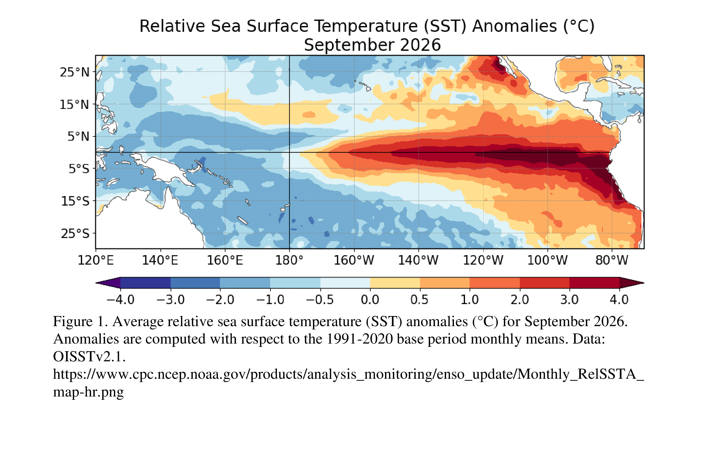
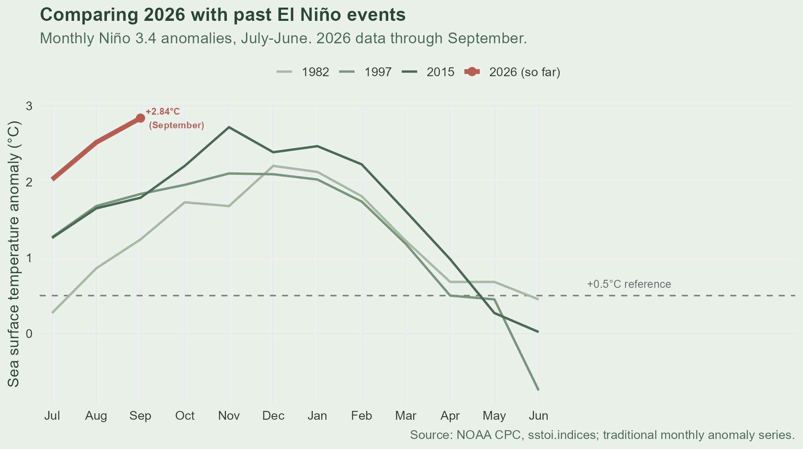
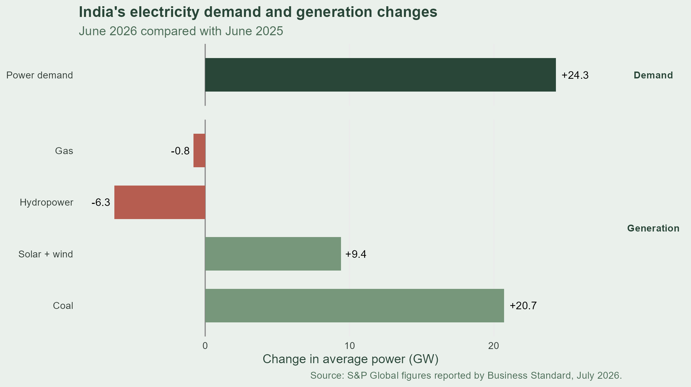

##### NOAA — 83%+ Chance of a strong-to-very-strong El Niño

{fig-align="center" width="100%"}

<small>Figure: [NOAA Climate Prediction Center, October 2026.](https://www.cpc.ncep.noaa.gov/products/analysis_monitoring/enso_disc_oct2026/figure01.gif)</small>

::: notes
How can a warming patch of ocean in the Pacific affect electricity demand in India? NOAA's October outlook gives a greater than 83% chance of a strong-to-very-strong El Niño continuing through early 2027. El Niño affects weather patterns far beyond the Pacific. I'll use a short R analysis to explore the climate data, then connect it to India's electricity system.
:::

## One ocean pattern, worldwide effects

**What is El Niño?**

Periodic warming of the central and eastern tropical Pacific that influences weather patterns around the world.

**How do we measure it?**

The Niño 3.4 index tracks sea surface temperature anomalies in a specific region of the tropical Pacific.

**Why does it matter?**

El Niño can influence rainfall patterns, including India's monsoon, with potential effects on hydropower and electricity systems.

::: notes
El Niño is part of a recurring climate pattern called ENSO. It involves changes in ocean temperatures and atmospheric conditions across the tropical Pacific.

One way we measure it is with the Niño 3.4 index, which tracks how much sea surface temperatures differ from normal in a particular region.

A sustained positive anomaly, together with the associated atmospheric response, signals El Niño conditions. These changes can influence rainfall far away, including India's monsoon.

So let's see what the data tells us.
:::

## Comparing past El Niño events

<small>**1. Select the data**</small>

<small>Downloaded NOAA's monthly Niño 3.4 data and selected the temperature anomaly column.</small>

<small>`nino <- raw |> select(YR, MON, nino34 = ANOM.3)`</small>

<small>**2. Align historical events**</small>

<small>Organized the data from July through June to compare the same months across different El Niño events.</small>

<small>`event_data <- nino |> filter(YR %in% c(1982, 1997, 2015, 2026))`</small>

<small>**3. Visualize the results**</small>

<small>Used `ggplot2` to create a line chart comparing three historical events with 2026.</small>

<small>`ggplot(event_data, aes(x = month, y = nino34, color = event)) + geom_line()`</small>

::: notes
To explore this, I downloaded NOAA's public monthly Niño 3.4 data and used R to compare three historical El Niño events with 2026.

First, I selected the anomaly column I wanted to analyze. The dataset contains several similar columns, and I initially selected the wrong one. Checking the values against the source helped me catch and correct that mistake.

Next, I aligned each event from July through June so I could compare the same months across different years. Finally, I used ggplot2 to create a line chart, with 2026 highlighted in red.

This is a simplified exploration using one monthly index. NOAA's official ENSO monitoring uses additional indicators and more comprehensive methods. With that in mind, let's look at what the comparison reveals.
:::

## What the Graph Reveals

{fig-align="center" width="100%"}

<small>Monthly Niño 3.4 temperature anomalies (°C). 2026 data available through September.</small>

::: notes
The red line represents 2026, and the blue lines show the three historical events.

The peak in the 2026 data so far was 2.84°C in September. For comparison, the peaks in the selected monthly series were 2.21°C in December 1982, 2.11°C in November 1997, and 2.72°C in November 2015.

So, 2026 has reached a higher monthly anomaly than these three historical events in the data available so far. However, 2026 is still ongoing, and this comparison alone doesn't establish how the event will ultimately rank in strength.

This raises a broader question: how might a climate pattern in the Pacific affect weather and electricity systems thousands of miles away, particularly in India?
:::

## India's Electricity System

{fig-align="center" width="100%"}

<small>Change in average power, June 2026 vs. June 2025 (GW). Source: [S&P Global, reported by Business Standard, July 2026.](https://www.business-standard.com/industry/news/el-nino-drives-6-3-gw-decline-in-india-s-june-hydropower-generation-s-p-126070700970_1.html)</small>

::: notes
So how might El Niño matter for India's electricity system?

El Niño can influence India's monsoon rainfall. When rainfall is lower, less water may flow into reservoirs, limiting the water available for hydropower generation. [India's 2026 monsoon ended about 13% below its long-term average](https://indianexpress.com/article/india/india-driest-monsoon-decade-el-nino-rainfall-deficit-10900646/).

In June, electricity demand increased by 24.3 gigawatts compared with the previous year, while hydropower generation fell by 6.3 gigawatts. Coal generation rose by 20.7 gigawatts, alongside a 9.4-gigawatt increase in solar and wind.

S&P Global identifies El Niño-related rainfall and reservoir inflows as part of the hydropower outlook. This matters because hydropower can respond quickly to changes in demand, so reduced output can make it harder to balance the grid. The figures illustrate the challenge of maintaining reliable electricity as climate conditions change.
:::

## From Climate Data to Energy Planning

**Identify patterns**

Use data to explore climate trends and compare historical events.

**Connect the dots**

Understand how rainfall patterns can affect water availability and hydropower generation.

**Inform decisions**

Use evidence to support climate-informed energy planning and grid reliability.

::: notes
This example shows how data science can connect a climate pattern to a real-world challenge.

Using R, I explored NOAA's monthly data and compared the current Niño 3.4 anomalies with historical events. I then connected that analysis to published electricity data to examine why rainfall and hydropower matter for India's power system.

The analysis doesn't prove that El Niño caused all the changes we observed. Instead, it shows how data can help us identify patterns, investigate relationships, and ask better questions.

Ultimately, this kind of analysis can support climate-informed energy planning and help decision-makers prepare for uncertainty.
:::
